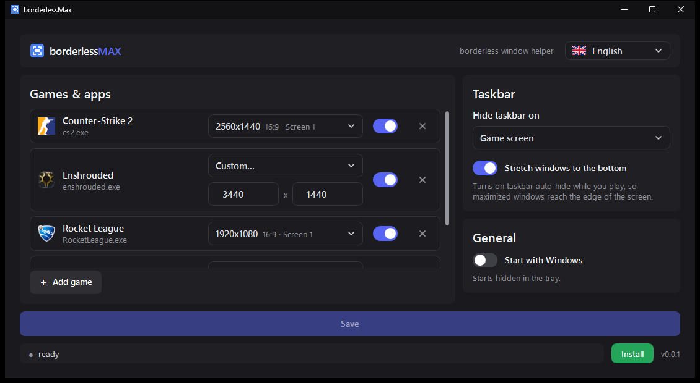
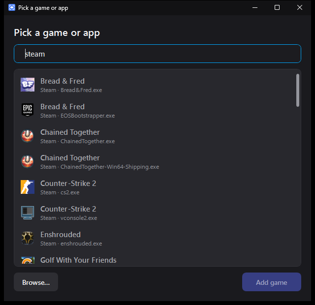

<p align="center"></p>

<h1 align="center">borderlessMax</h1>

<p align="center">Borderless, centered game windows on ultrawide and multi-monitor setups, without the taskbar in the way. For Windows 10 and 11.</p>





## Why

On a 5120x1440 ultrawide you often want a game at 2560x1440 in the middle of the screen. Windows gets in the way twice:

1. **The taskbar stays on top of the game.** Windows only hides it for windows that cover the *whole* screen, and a
   centered window narrower than the screen never does.
2. **Some games stretch to the full width** in borderless mode and ignore the resolution you picked.

borderlessMax runs in the tray and fixes both while a game from your list has focus.

## Features

- **Borderless and centered**: the game gets a borderless window of the size you set, centered on its screen. If the
  game resizes itself, it snaps back within half a second.
- **Taskbar out of the way** while you play, two ways:
  - *Behind the game* (default): the taskbar stays visible, the focused game is drawn in front of it.
  - *Hide*: the taskbar disappears, on the game's screen or on all screens. Optionally **stretch windows**: taskbar
    auto-hide turns on while you play, so maximized windows next to a centered game reach the bottom of the screen.

  Everything is back to normal when you tab out, minimize or close the game, or quit borderlessMax.
- **Game picker**: lists the programs and games on this PC (Steam, Epic, Xbox, Riot, Start menu, installed apps,
  running apps) with icons and a search field (searches name, exe and store). *Browse…* adds any other exe.
- **Default resolution** for all games, from the list your screens really support (with aspect ratio) or any custom
  size. A game that needs its own: the ✎ button in its row opens its settings (name, exe, resolution).
- **Saves as you go**: every change is stored right away, no save button.
- **Discord look**, the same dark theme as [captureMax](https://github.com/maxschroers/captureMax): dark panels,
  blurple switches and buttons, a dark title bar.
- **Installs per user** without admin, starts with Windows if you want, **updates itself** from GitHub releases.
- **German and English UI**: follows the system language, switchable in the header.
- One exe with .NET inside: nothing else to install.

## Download

Grab `borderlessMax-windows.exe` from the [latest release](../../releases/latest). Run it, it works portable.
SmartScreen may warn about an unknown publisher: *More info → Run anyway*. Click **Install** (bottom right) to
install it for your user, no admin needed: it goes to `%LOCALAPPDATA%\Programs\borderlessMax`, gets a Start menu
entry, updates itself and can be removed under *Settings → Apps*.

## Usage

1. Set the game itself to **windowed** or **borderless** mode at the resolution you want.
2. In borderlessMax set the **default resolution**, click **Add game** and pick the game (or *Browse…* to its exe).
   For a different size, click ✎ in the game's row.
3. Start the game: it gets centered and borderless, the taskbar disappears.

Closing the window keeps borderlessMax running in the tray (click the tray icon to open it again, right-click to quit;
hovering it shows the active game). Settings live in `%APPDATA%\borderlessMax\settings.json`.

## Build locally

Needs the [.NET 10 SDK](https://dotnet.microsoft.com/download):

```sh
dotnet run                                   # run from source
dotnet run -- --selftest                     # logic checks (CI runs them before every build), exit code 0 = passed
dotnet publish -c Release -o publish         # publish/borderlessMax.exe, one file with .NET inside
```

## Releasing

[`.github/workflows/release.yml`](.github/workflows/release.yml) builds, self-tests and smoke-tests on every push and
pull request. Pushing a version tag also publishes a GitHub release with the exe and generated notes:

```sh
git tag v0.1.1
git push origin v0.1.1
```

The workflow passes the tag as the version into the build (local builds show `dev` and skip the update check).
Versions follow [semantic versioning](https://semver.org) (`vMAJOR.MINOR.PATCH`).

## Contributing

Bug reports, ideas and pull requests are welcome, see [CONTRIBUTING.md](CONTRIBUTING.md). Questions go to
[Discussions](../../discussions), security issues to [SECURITY.md](SECURITY.md).

## Troubleshooting

| Problem | Fix |
|---|---|
| Nothing happens with a game that runs as admin | Windows blocks moving windows of elevated apps. Run borderlessMax as admin too. |
| Game stays fullscreen / black screen | Exclusive fullscreen isn't supported. Set the game to windowed or borderless. |
| The game wasn't found in the picker | Use *Browse…* and pick its exe. For launcher games, pick the game's exe, not the launcher's (e.g. `...-Win64-Shipping.exe` for Unreal games). |
| Taskbar stays hidden after borderlessMax was killed (e.g. Task Manager) | Start borderlessMax again and quit it from the tray, or restart Explorer and turn off auto-hide in the taskbar settings. |
| Other screens' taskbars hide themselves while playing | That's *Stretch windows*: auto-hide is one setting for all screens. Turn it off if you don't need it. |

## License

[MIT](LICENSE)
